<p align="center">
  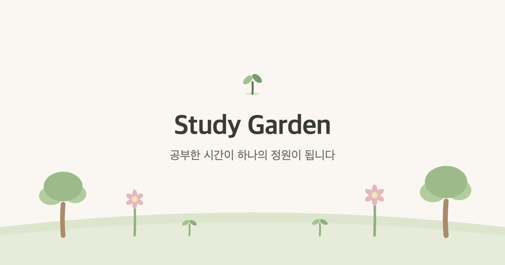
</p>

<h1 align="center">Study Garden</h1>

<p align="center">공부한 시간이 하나의 정원이 됩니다.</p>

---

## 프로젝트 소개

Study Garden은 공부 타이머 앱입니다. 집중 세션을 끝까지 마치면 정원에 씨앗이 심어지고,
공부 시간이 쌓일수록 새싹 → 잎 → 꽃 → 나무로 자랍니다. 한 달의 공부가 하나의 정원이 되고,
정원들이 모여 나의 숲이 됩니다.

기능은 세 화면이 전부입니다 — **정원과 타이머**, **기록과 캘린더**, **숲과 업적**.
회원가입도, 서버도, 알림도 없습니다. 열면 바로 정원이 있고, 30분 뒤에 식물이 하나 늘어 있습니다.

2026년 11월, 학생이 **"오늘 무엇을 할지"부터 "한 달을 어떻게 보냈는지"까지** 정원 안에서
이어서 볼 수 있도록 공부 계획 기능을 더했습니다 — 오늘의 목표, 과목별 꽃, 시험 D-day,
월간 정원 정리 카드([설계 문서](docs/03_study-planner.md)).

## 문제 정의 — 왜 만들었는가

이 프로젝트는 두 가지 질문에서 시작했습니다.

**첫째, 공부 시간은 왜 소모처럼 느껴질까.**
타이머 앱의 시간은 흘러가면 사라집니다. 통계 화면의 막대그래프는 어제의 나를 숫자로만
남깁니다. 그런데 숫자는 애착의 대상이 되지 못합니다. 지난달에 42시간을 공부했다는 사실보다,
지난달의 정원에 나무가 세 그루 서 있다는 사실이 더 오래 기억에 남습니다. 시간을 **축적이
보이는 형태**로 바꾸면, 공부를 시작하는 마음의 비용이 낮아질 거라고 가정했습니다.

**둘째, 생산성 앱은 왜 차가울까.**
Forest는 나무를 심고, Finch는 새를 키우고, 동물의 숲은 섬을 가꿉니다. 이들의 공통점은
사용자가 앱을 "쓰는" 게 아니라 무언가를 "돌보러 온다"는 감각입니다. 반면 대부분의 공부
앱은 관리자의 얼굴을 하고 있습니다. 이 프로젝트의 목표는 그 사이 — **Apple의 정돈됨과
동물의 숲의 온기 사이**에 있는, 20대 대학생이 유치하다고 느끼지 않을 만큼의 귀여움이었습니다.

그래서 이 앱의 설계 원칙은 처음부터 하나였습니다:

> 사용자가 앱을 열었을 때 '공부 앱을 켰다'가 아니라 **'내 정원을 돌보러 왔다'**고 느끼게 할 것.

기능을 늘리는 대신 뺐고(백엔드 없음, V1의 설정은 집중 시간과 정원의 계절 둘뿐), 개발 기간의 절반 이상을
기능이 아니라 여백·색·움직임·문장을 다듬는 데 썼습니다.

### 공부 계획 고도화 — 무엇을 더했고, 무엇을 더하지 않았나

타이머 앱은 "얼마나" 했는지는 기록하지만 "무엇을" 했는지는 모릅니다. 학생에게 필요한 건
매일의 작은 목표와, 그 목표가 시험이라는 큰 목적지로 이어진다는 감각이었습니다. 그래서 정원의
은유를 그대로 확장했습니다 — **목표를 다 이루면 꽃이 피고, 과목마다 다른 꽃이 자라고, 시험까지
남은 날이 정원 위에 적혀 있고, 한 달이 끝나면 정원 한 장으로 돌아봅니다.**

더하지 않은 것도 정했습니다: 알림, 반복 할 일, 장기 플래너, 달성하지 못한 날의 페널티(시드는 식물·경고
문구). 목표를 못 이뤄도 잃는 것은 없습니다 — 이 앱의 정원은 벌을 주지 않습니다.

## 핵심 기능

- **집중 타이머** — 30/45/60/90분. 끝까지 마치면 씨앗이 심어지고, 중간에 포기하면 사라집니다.
  긴장감이 곧 게임 규칙입니다. 새로고침이나 브라우저 종료에도 진행 중인 세션은 복원됩니다.
- **살아있는 정원** — 식물은 심은 이후 누적 공부 시간으로 자랍니다(90분 → 잎, 270분 → 꽃,
  540분 → 나무). 모든 식물이 저마다 다른 주기로 바람에 흔들리고, 꽃머리는 줄기와 따로 미세하게
  움직입니다.
- **사계절** — 접속한 날짜의 계절이 팔레트를 결정합니다. 봄엔 벚꽃잎이 하나씩 떨어지고,
  여름밤엔 반딧불이 깜빡이고, 가을엔 낙엽이, 겨울엔 눈송이가 내립니다. 다크모드는 계절마다
  다른 톤의 밤이 됩니다. 원하면 설정에서 좋아하는 계절에 머무를 수도 있어요.
- **기록** — 월별 정원 아카이브와 잔디 캘린더. 지난달의 정원을 언제든 다시 볼 수 있습니다.
- **숲** — 평생 누적 공간. 총 공부 시간, 씨앗→나무 5단계 성장 여정으로 표현되는 레벨,
  8개의 업적(잠긴 업적은 안개 속에, 획득하면 꽃이 피듯 등장).
- **예시 정원 구경하기** — 아직 기록이 없는 첫 방문이라면 빈 정원 아래 버튼 하나로 "한 달 가꾼 정원"을
  읽기 전용으로 둘러볼 수 있어요. 첫 식물까지 30분을 기다리지 않아도 앱이 무엇을 하는지 보입니다.
  예시는 내 기록에 아무것도 저장하지 않습니다 (docs/04).

### 공부 계획 (docs/03)

- **오늘의 목표** — 할 일을 적고 그중 1~3개를 핵심(별)으로 정합니다. 핵심을 모두 마친 날엔
  정원 앞줄에 별 모양 **달성 꽃**이 한 송이 핍니다. 어제 못 한 일은 버튼 하나로 가져옵니다.
  지난 날은 읽기 전용이라, 나중에 체크해서 꽃을 만들 수 없습니다.
- **과목별 꽃** — 과목을 최대 5개 등록하면 과목마다 튤립·해바라기·라벤더·수국·동백이 배정됩니다.
  타이머를 시작할 때 "무엇을 가꿀까요?"에서 할 일이나 과목을 고르면 그 세션의 식물이 그 꽃으로 핍니다.
  정원만 봐도 이 달의 과목 분포가 보입니다. 과목 색은 라이트·다크 모두와 적록색약 시뮬레이션에서
  구분되도록 실측해 골랐습니다.
- **시험 D-day** — 시험을 적어 두면 정원 위에 "기말고사까지 18일" 한 줄. 남은 날만 보여줍니다.
- **월간 정원 정리** — 기록 페이지에서 그달의 가꾼 시간·공부한 날·식물·목표 꽃·과목 비율을 한 장으로.
  **이미지로 저장**하면 정원이 들어간 PNG가 만들어지고, 모바일에선 공유 시트가 열립니다.

## 스크린샷

| 홈 — 정원과 타이머 | 다크모드 | 집중 중 |
|---|---|---|
| 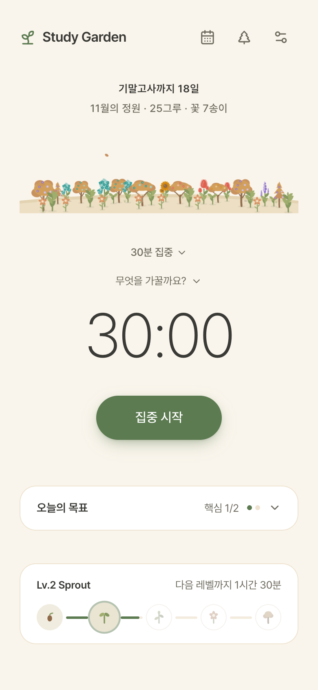 | 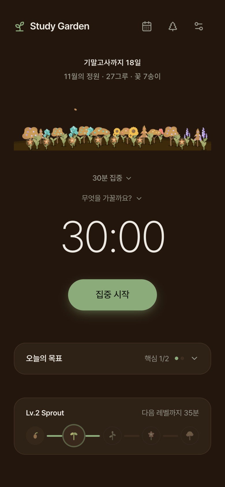 | 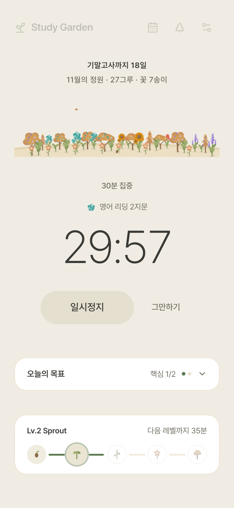 |

| 오늘의 목표 | 무엇을 가꿀까요? | 과목·시험 설정 |
|---|---|---|
| 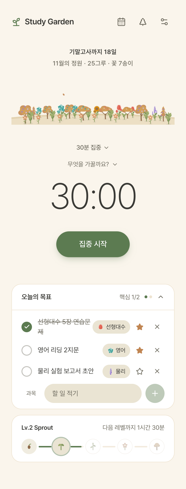 | 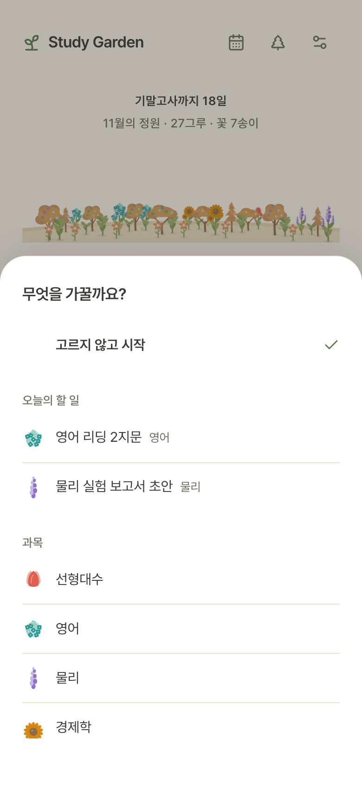 | 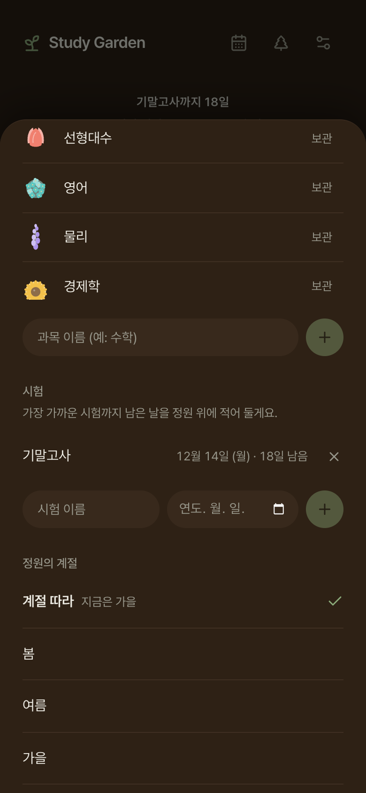 |

| 기록 — 달성한 날 꽃 표시 | 월간 정리 카드 | 내보낸 이미지 |
|---|---|---|
| 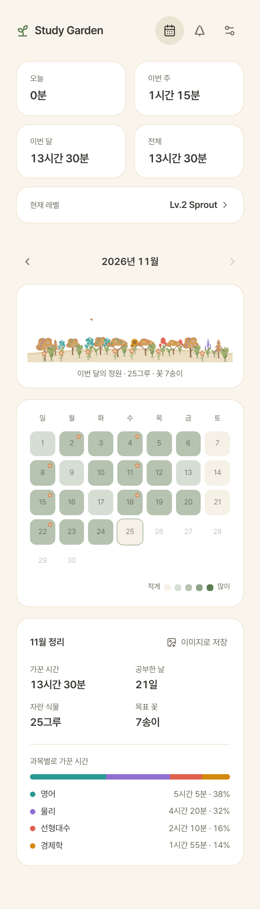 | 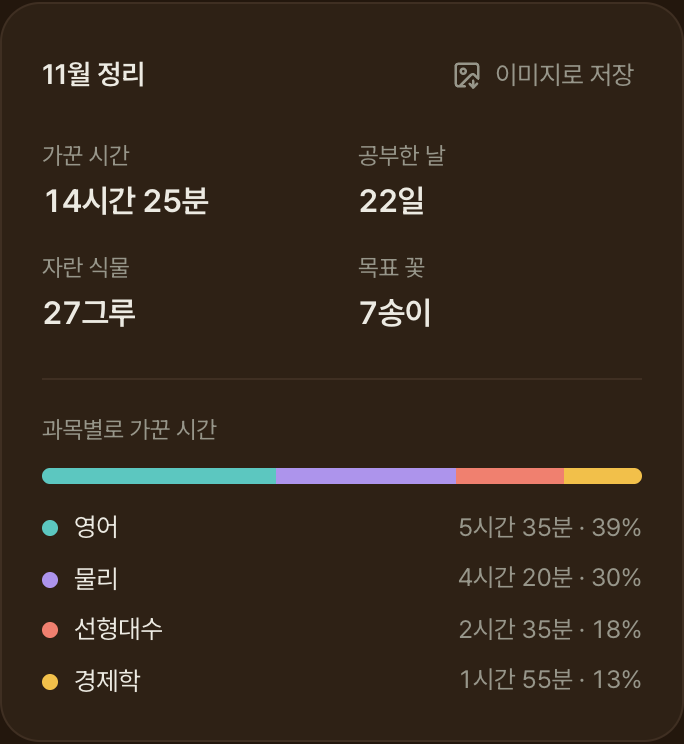 | 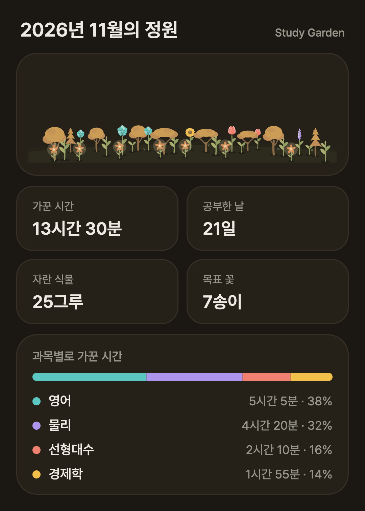 |

| 첫 방문 | 숲 | 숲 (다크) |
|---|---|---|
| 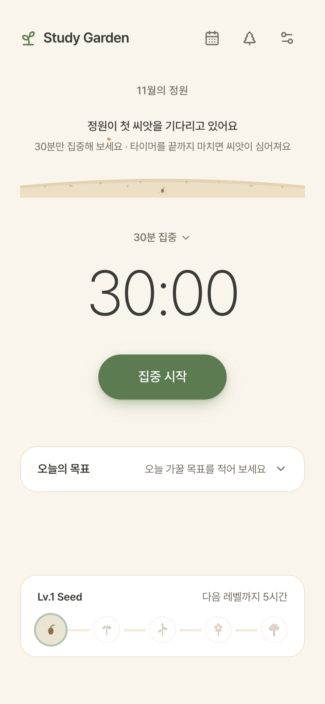 | 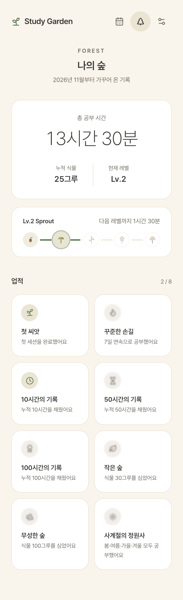 | 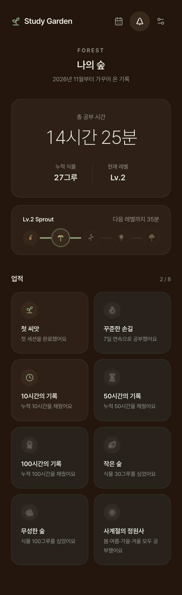 |

## 실행 방법

```bash
npm ci
npm run dev      # http://localhost:3210 (전용 고정 포트 — localStorage가 포트별로 따로라서)
npm test         # lib 골든 테스트 67개 (Node 24 내장 node --test)
npx next build   # 정적 빌드
```

배포판: https://study-garden-omega.vercel.app (main 푸시 시 자동 배포). 데이터는 브라우저에만 저장됩니다.

## 기술 스택

Next.js 16 (App Router) · React 19 · TypeScript · Tailwind CSS v4 · framer-motion · zustand

백엔드 없음 — 모든 데이터는 localStorage에 저장됩니다. 정적 페이지 4장으로 빌드됩니다.
공부 계획 기능은 **새 라이브러리 없이** 만들었습니다(PNG 내보내기 포함).

## 아키텍처

```
app/            페이지 3개 + template.tsx(페이지 전환) + globals.css(디자인 시스템 전체)
components/     garden/(SVG 정원·식물·달성 꽃) · timer/ · home/(오늘의 목표) · records/(정리 카드·PNG) · settings/ · ui/
stores/         zustand — sessions · timer · ui · season · tasks · subjects · exams
lib/            순수 함수 — 세션→식물 배치, 레벨, 통계, 계절, 업적, 목표 판정, 과목, D-day, 월간 정리
                (*.test.ts 골든 테스트가 옆에)
lib/storage/    localStorage repository — 기존 키는 그대로, 새 키 3개(tasks·subjects·exams)만 추가
```

- **하위 호환.** 저장 형식은 그대로라 고도화 전의 기록도 마이그레이션 없이 읽힙니다. 기능 단계(M1~M5) 동안은
  과목 없는 기존 기록이 V1과 **픽셀 단위로 같은 정원**을 그리는지 스크린샷 바이트 비교로 지켰고, 그 뒤 식물 아트를
  의도적으로 풍성하게 바꿨습니다(아래).
- **풍성한 정원 (2026-11-25 개정).** 새싹은 잎 세 장, 잎 단계는 작은 덤불, 꽃은 곁가지 꽃 두 송이, 나무는 수관 위에 작은 꽃이
  핍니다. 과목 식물은 곁꽃·나무 꽃까지 과목색이라 **나무가 돼도 과목이 보이고**, 과목 없는 식물은 계절색이 섞여 알록달록합니다.

- **디자인 토큰이 유일한 진실.** 색·그림자·라운드는 전부 `globals.css`의 CSS 변수로 정의되고,
  Tailwind `@theme inline`을 거쳐 유틸리티가 됩니다. 컴포넌트에는 hex 코드가 없습니다.
  계절 4종 × 라이트/다크 = 8개 팔레트가 이 한 파일에 있습니다.
- **정원은 하나의 SVG 좌표계.** viewBox 800×250, 모든 식물은 뿌리가 (0,0)인 로컬 좌표로
  그려지고 지면 곡선 함수(`groundTopY`)를 따라 배치됩니다. 식물의 위치·품종은 세션 id의
  해시로 결정적으로 계산됩니다 — 같은 기록은 언제나 같은 정원을 그립니다.
- **애니메이션 이원화.** 수십 개가 동시에 도는 무한 루프(흔들림·계절 입자·글로우)는 CSS
  keyframes, 등장·스프링·전환은 framer-motion. `prefers-reduced-motion`에서는 장식 애니메이션이
  전부 꺼집니다.

## 구현 포인트

- **하이드레이션 안전한 계절 시스템** — 계절별 입자를 넷 다 DOM에 렌더하고 CSS
  `html[data-season=...]` 선택자로 하나만 표시합니다. JS 분기가 없으니 SSG와 클라이언트가
  다른 화면을 그릴 일이 없습니다.
- **세션 복원** — 진행 중 타이머는 종료 시각(epoch)으로 저장됩니다. 자리를 비운 사이 시간이
  다 지났다면, 복귀 시 완주로 인정하고 씨앗을 심은 뒤 완료 화면을 보여줍니다.
- **포기 확인 UI** — 경고 문구가 나타나도 버튼이 밀리지 않도록 자리를 항상 예약해 두는
  구조(레이아웃 시프트 실측 2px). 포기를 고민하는 순간이 이 앱에서 감정적으로 가장 중요한
  화면이라고 판단했습니다.
- **라이브러리 없는 PNG 내보내기** — 화면의 정원 SVG를 복제해 계산된 색(fill·stroke·opacity)을
  속성으로 굳힌 뒤 카드 전체를 SVG로 조립 → `<canvas>` → PNG. 이미지 안에서는 CSS가 적용되지
  않으므로 CSS 변수·계절 선택자·애니메이션을 전부 값으로 바꿔야 합니다. 글자는 SVG `<text>`가 웹폰트를
  못 불러오는 문제 때문에 `document.fonts` 로드 후 canvas에 직접 씁니다.
- **골든 테스트** — 판정이 들어가는 순수 함수(목표 달성, 과거 날짜 잠금, 꽃 배치 결정성, 과목 종 배정,
  D-day 날짜 경계, 월간 비율, 예시 정원 결정성)는 Node 내장 `node --test`로 67개 케이스를 검증합니다. 기대값 표는 구현이
  스스로 만들지 않고 사람이 먼저 검수·승인한 뒤 테스트로 옮겼고, 규칙을 일부러 깨뜨린 변형에서 해당
  케이스가 실패하는지도 확인했습니다. 화면 흐름은 Playwright 시나리오 6개(155개 검사)로 돌립니다.
- **접근성** — 보조 텍스트 대비 4.9:1, primary 버튼 흰 글자 4.8:1(WCAG AA), 전역
  focus-visible 링, 44px 탭 타깃, safe-area 대응.

## 트러블슈팅

| 증상 | 원인과 해결 |
|---|---|
| 다크모드에서 특정 계절의 색이 샌다 | 다크 base 블록이 라이트 계절 블록보다 CSS에서 뒤에 오는 **캐스케이드 순서**로 동작하는 구조라, base가 모든 계절 변수를 덮어야 한다. 하나라도 빠지면 라이트 값이 누출 — 규칙을 CLAUDE.md에 문서화 |
| 겨울 눈송이가 라이트 모드에서 안 보임 | 눈 색이 배경과 4% 차이. "구현했다"와 "보인다"는 다르다 — 모든 시각 변경을 스크린샷으로 실측하는 루프를 만들고, 색을 계절 accent로 교체 |
| 포기 확인 시 버튼이 두 줄로 깨짐 | 버튼 라벨을 상태에 따라 갈아끼운 것이 원인. 라벨은 고정하고 경고는 자리가 예약된 별도 줄로 — 출시 심사에서 잡힌 P0 |
| 진행 중 세션이 새로고침에 증발 | 타이머 상태가 메모리에만 존재. 종료 시각을 영속화하고 부재 중 완료를 복귀 시 정산 |
| QA가 엉뚱한 결과를 냄 | :3000에 **다른 프로젝트의 dev 서버**가 떠 있었다. 측정 전에 `<title>`로 대상부터 검증하는 습관이 생김 |
| 수십 그루 흔들림이 무거움 | framer-motion 무한 루프 대신 CSS keyframes + 개체별 `--sway-a` 변수로 GPU에 위임 |
| 꽃이 뿌리가 아니라 가운데에서 자라남 | SVG에서 framer-motion이 `style.transformOrigin`을 `50% 50%`로 덮어쓴다(DOM 실측). `originX`/`originY`로 지정해 해결 — 기존 식물 등장에도 있던 버그를 같이 고침 |
| 과목 꽃이 색약 사용자에게 구분 안 됨 | 첫 팔레트에서 수국(파랑)·라벤더가 적록색약 시뮬레이션 색차 2.5로 겹침. 후보 3개를 대비·색차·색약 시뮬로 측정해 수국을 청록으로 옮김 (최소 색차 10.1 이상) |
| 내보낸 이미지 글꼴이 "여기선 맞는데" | 개발 Mac에 Pretendard가 **로컬 설치**돼 있어 SVG 텍스트 방식도 정상으로 보였다. 로컬 글꼴을 빼고 재측정하니 다른 기기에선 대체 글꼴로 떨어짐 → canvas 방식 채택 |
| 테스트는 통과인데 스크린샷이 빈 화면 | Playwright 가짜 시계 설치 후 새로고침을 거듭하면 애니메이션이 opacity 0에 멈춘다. `isVisible()`은 opacity를 보지 않아 통과했었다 → 조상 opacity까지 검사 추가 |

## 배운 점 — What I Learned

**1. 완성도는 기능이 아니라 상태의 개수다.**
화면 3개짜리 앱인데 검증해야 할 상태는 40개가 넘었습니다(3화면 × 라이트/다크 × 4계절 +
엠티/집중 중/일시정지/포기 확인/완료…). "기능 추가 금지"를 선언한 뒤에야 이 상태들이 보였고,
출시를 막은 결함은 전부 기능이 아니라 상태의 틈에서 나왔습니다. 다음 프로젝트에서는 상태
매트릭스를 먼저 그리고 시작할 겁니다.

**2. 디자인 토큰은 미학이 아니라 아키텍처다.**
색을 CSS 변수 한 층 뒤에 숨긴 결정 덕분에, 다크모드 전체 구축이 컴포넌트 수정 0건으로
끝났고, 접근성 대비 수정도 변수 두 개를 바꾸는 일이었습니다. 하드코딩된 색 하나가 나중에
지불하게 될 비용을 이 프로젝트 규모에서도 체감했습니다.

**3. "예쁘다"는 주장이고, 스크린샷은 증거다.**
빌드가 통과해도 눈송이는 안 보일 수 있고, 대비는 3.3:1일 수 있고, 버튼은 두 줄로 깨질 수
있습니다. 이 프로젝트에서 가장 값진 산출물은 코드가 아니라 **"모든 시각 변경은 실제 렌더링을
캡처해서 눈으로 확인한 뒤 완료라고 말한다"는 작업 규칙**과 그것을 자동화한 스크린샷
하네스였습니다. 접근성 대비처럼 눈으로도 안 되는 것은 수치로 쟀습니다.

**4. 감성은 큰 연출이 아니라 작은 규칙의 합이다.**
"살아있다"는 느낌은 화려한 애니메이션이 아니라 — 나무는 새싹보다 느리게 흔들린다,
벚꽃잎은 5.5초에 한 장이다, 경고 문구는 나타나도 아무것도 밀지 않는다, 빈 정원은 "비어
있다"가 아니라 "기다린다"고 말한다 — 같은 작은 결정들이 쌓여서 만들어졌습니다. 그리고
그 규칙들은 문서로 남겨야만 다음 작업에서도 지켜집니다.

**5. 마감의 기준은 남이 정해줘야 한다.**
스스로는 "거의 다 됐다"고 느낄 때 Apple 심사관의 눈으로 다시 보니 P0가 4개 나왔습니다.
출시 기준을 외부 시선(심사 체크리스트)으로 명문화하는 것이, 완성도를 감이 아니라 공정으로
만드는 방법이었습니다.

## 향후 계획

V1은 여기서 종료하고 유지보수 모드로 전환합니다. 다음을 V2 후보로 기록해 둡니다.

V1 이후 완료: **Vercel 배포**(https://study-garden-omega.vercel.app) · **PWA 설치 지원**(docs/02 — Dock·홈 화면에 앱으로 설치)
· **공부 계획 고도화**(docs/03 — 오늘의 목표·과목별 꽃·시험 D-day·월간 정원 정리와 이미지 공유).

- 커스텀 도메인 연결 (주의: 설치·localStorage가 origin 단위라 데이터 이전 계획 선행 — docs/02 리스크 참조)
- 시트 접근성 마무리 (Escape 닫기, 포커스 트랩)
- 통계 심화 (주간 리듬, 시간대 분포) — 월간 정리 카드가 과목 비율까지 담당
- 서비스명·브랜딩 재검토

---

<p align="center"><sub>정원은 하루아침에 자라지 않습니다. 오늘 30분부터.</sub></p>
